<div align="center">

# Tarkov Hideout for Switch, PC and Android

**An offline Escape From Tarkov companion for Nintendo Switch homebrew, Windows, Linux and Android tablets.**
Hideout planner and craft timers, sharp interactive maps, an ammo chart, a gun builder, a quest screen like the game's, a Kappa tracker and a quest database, in 13 color themes, in your hands between raids or on your second screen while you play.

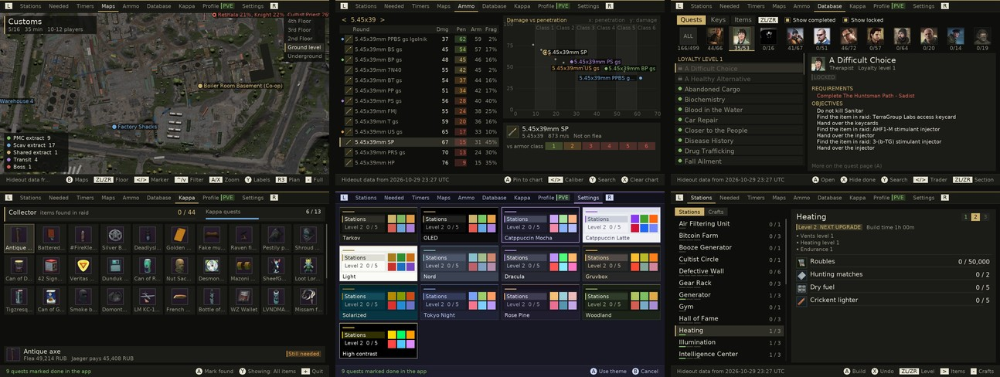

[Install](#install) · [PC](#pc-second-screen) · [Android](#android-tablets-and-chromebooks) · [Hideout](#hideout) · [Maps](#maps) · [Ammo](#ammo) · [Gun builder](#gun-builder) · [Quests](#quests) · [Database](#database) · [Kappa](#kappa) · [Themes](#themes) · [Profile and sync](#profile-and-tarkovtracker-sync) · [Controls](#controls) · [Building](#building)

</div>

---

## Highlights

- **Every hideout station and level**, with the items, tools and skills each one needs, and what you still have to find across the whole hideout.
- **Crafts and timers** right next to your stations, with timers that keep running while the Switch sleeps.
- **16 maps built from the game's own renders**, sharp up to 16x zoom, with extracts, transits, boss spawns and every floor of the multi-level maps.
- **An ammo tab** with an eft-ammo style damage vs penetration chart. Pin rounds to compare them.
- **A gun builder like the game's modding screen**: every weapon and every mod that fits, with live ergonomics, recoil, weight and price against the default build.
- **A quest screen like the game's**: trader portraits, quests grouped by loyalty level, and a side panel with requirements, objectives and rewards. Hide the quests you can't take yet once you sync.
- **Catch up your quest history in a few presses**: point at the quests you're on, and everything before them is marked done, on TarkovTracker too.
- **Quest guides** from the wiki, pictures included, next to objectives, map pins and rewards.
- **Kappa tracker** for every Collector item, saved as you find them, with Kappa quest progress.
- **13 color themes** with a live-preview picker: OLED, Catppuccin, Nord, Dracula, Gruvbox, Light and more.
- **TarkovTracker sync that never loses your work**: it merges with the hideout levels you set in the app.
- **Works fully offline.** Data, icons, maps and wiki pictures ship inside the app and refresh daily when you're online.
- **Runs on your PC too.** The same app for Windows and Linux, in a resizable window for a second screen, with mouse, keyboard or controller.
- **And on Android tablets and Chromebooks**, in landscape with touch controls.
- **Never talks to Battlestate's servers.** Game data comes from [tarkov.dev](https://tarkov.dev), and you can pull your progress from [TarkovTracker](https://tarkovtracker.org).

## Install

### Switch

1. Download `TarkovHideout.nro` from the [latest release](../../releases/latest).
2. Copy it to `sdmc:/switch/` on your SD card.
3. Launch it from the Homebrew Menu. For the most memory, and for the on-screen keyboard, launch through title override (hold R while starting a game).

Progress and settings are saved in `sdmc:/switch/TarkovHideout/`. The app is a few hundred MB because every map piece and wiki picture is bundled for offline use.

**Lite version.** `TarkovHideout-Lite.nro` is the same app in under 10 MB. It bundles the hideout, quest, ammo and item data, icons and map thumbnails, and downloads each map and wiki picture the first time you open it, then keeps it. Use it to save SD space if the Switch is usually online. Pick one of the two NROs; both use the same save folder.

### Windows

1. Download `TarkovHideout-windows-x64.zip` from the [latest release](../../releases/latest).
2. Unzip it anywhere and run `TarkovHideout.exe`. Nothing else to install.

### Android, tablets and Chromebooks

1. Download `TarkovHideout-android.apk` from the [latest release](../../releases/latest) on the device.
2. Open it and allow installing from your browser or file manager when Android asks. On a Chromebook, Android apps must be turned on in Settings, and APKs from outside the Play Store need [developer mode or ADB](https://developer.android.com/topic/arc/development-environment).

Android 5.0 or newer, ARM64 or x86_64. Like the Lite NRO it bundles the data and downloads maps and wiki pictures as you open them. See [Android](#android-tablets-and-chromebooks) for touch controls.

### Linux

1. Download `TarkovHideout-linux-x64.tar.gz` from the [latest release](../../releases/latest) and extract it.
2. Install SDL2 and curl if you don't have them. On Arch and CachyOS: `sudo pacman -S --needed sdl2 sdl2_ttf sdl2_image curl`. On Debian and Ubuntu: `sudo apt install libsdl2-2.0-0 libsdl2-ttf-2.0-0 libsdl2-image-2.0-0 libcurl4`.
3. Run `./TarkovHideout`. `TarkovHideout.desktop` and `icon.png` are included for a menu entry.

On PC, progress, settings and downloads are saved in `%APPDATA%\TarkovHideout` (Windows) or `~/.local/share/TarkovHideout` (Linux), so a new version can replace the old folder. Builds from the latest commit are also on the [Build desktop](../../actions/workflows/desktop.yml) workflow page, under Artifacts.

## PC second screen

The PC version is the same app with the same tabs, data and TarkovTracker sync, in a window you can put on a second monitor while you play. It fills a window of any size or shape, keeps text and maps sharp at high resolutions, and reopens where you left it. **Interface zoom** (Settings, Ctrl + / Ctrl -, or Ctrl+wheel) makes everything smaller, down to 50%, so a big window shows more rows, a wider ammo chart and more of the map. On Linux it runs as a native Wayland window when your desktop uses Wayland, so display scaling doesn't blur it.

<table>
<tr>
<td colspan="2">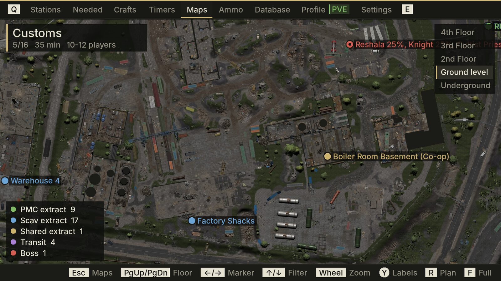</td>
</tr>
<tr>
<td width="50%">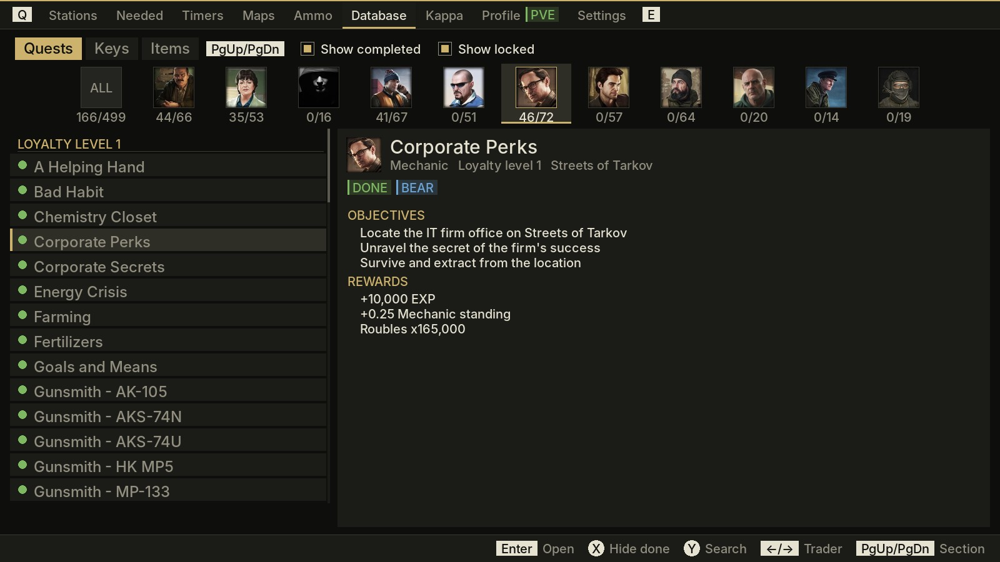</td>
<td width="50%">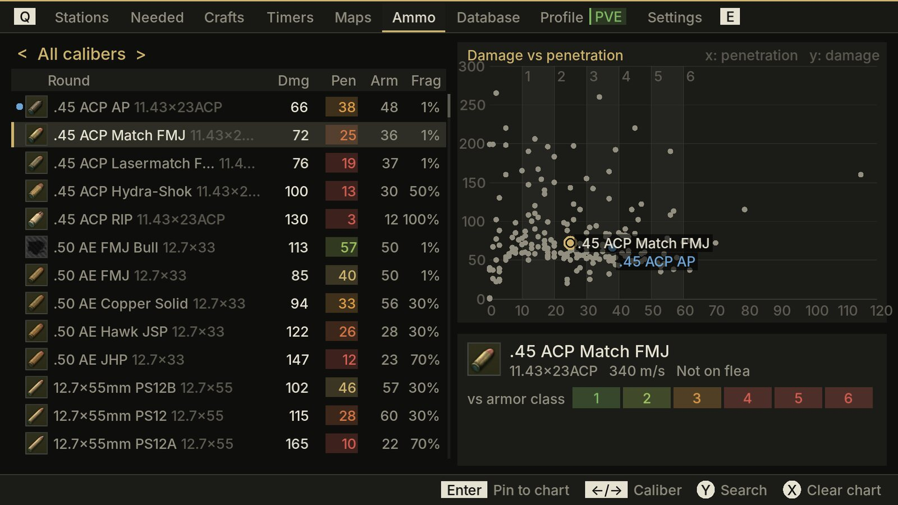</td>
</tr>
</table>

- **Mouse.** Click tabs, rows, the `< filter >` labels and the button hints at the bottom, which all work as buttons. Double-click a row for its main action: open a quest, start a craft, pin a round, or add one of a hideout item. The wheel scrolls lists and quest guides and zooms the map around the pointer. Drag to pan. Right-click goes back.
- **Keyboard.** The hints at the bottom show keys instead of Switch buttons:

  | Key | Action |
  | --- | --- |
  | 1 to 9, 0 | Jump to a tab (0 is Settings) |
  | Q / E, Tab | Previous / next tab |
  | Arrows, Enter, Esc | Move, select, back |
  | PgUp / PgDn | Same as ZL / ZR (floors, sections, levels) |
  | X, Y | Same as the Switch buttons |
  | Ctrl+F | Search |
  | F | Same as the Switch's - button: fullscreen map, stations / crafts, show locked quests |
  | R | Game render / vector plan |
  | F11 | Fullscreen window |
  | Ctrl + / Ctrl - / Ctrl 0 | Interface zoom: smaller, larger, reset (Ctrl+wheel too) |
  | Ctrl+Q | Quit |

- **Controller.** Any controller works like the Switch pad, and the hints switch back to Switch buttons while you use it.

Text boxes accept Ctrl+V, so you can paste your TarkovTracker token. It stays masked on screen apart from its last four characters, in case you stream the window.

## Android tablets and Chromebooks

The Android app is the same program built for touch screens, and always runs in landscape at the Switch layout, scaled to the screen.

- **Tap** tabs, rows, the `< filter >` labels and the button hints at the bottom. **Double-tap** a row for its main action.
- **Drag** to scroll lists and quest guides, and to pan maps. **Pinch** to zoom maps.
- The Android **Back** button or gesture goes back. Text boxes open the on-screen keyboard and have OK and Cancel buttons.
- A keyboard, mouse or controller works like on PC, for example on a Chromebook.

Progress and downloads stay in the app's private storage and are kept across updates. The APK is signed with a key that is published in this repository, so any build from here installs over the previous one.

## Hideout

<table>
<tr>
<td width="50%">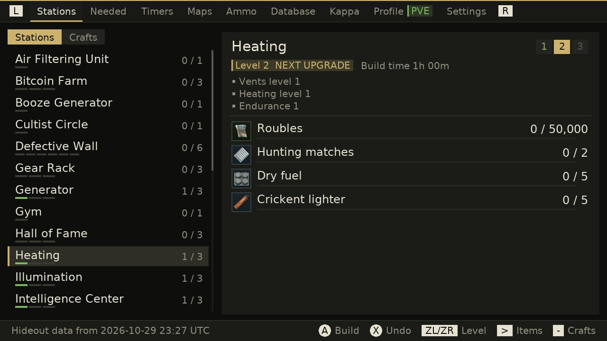</td>
<td width="50%">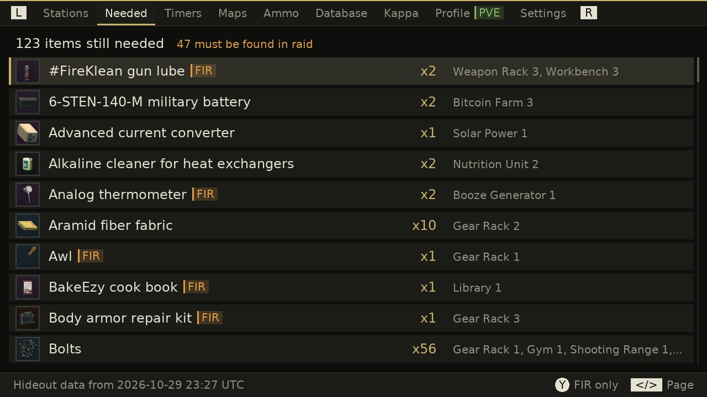</td>
</tr>
<tr>
<td><b>Stations</b>. Pick a station to see the next level's requirements, mark levels as built and track item counts. Found-in-raid items are tagged. The <b>Stations | Crafts</b> switch at the top (or -) flips to crafts.</td>
<td><b>Needed</b>. Everything still missing across the hideout, with which stations want it. Y shows only found-in-raid items.</td>
</tr>
<tr>
<td>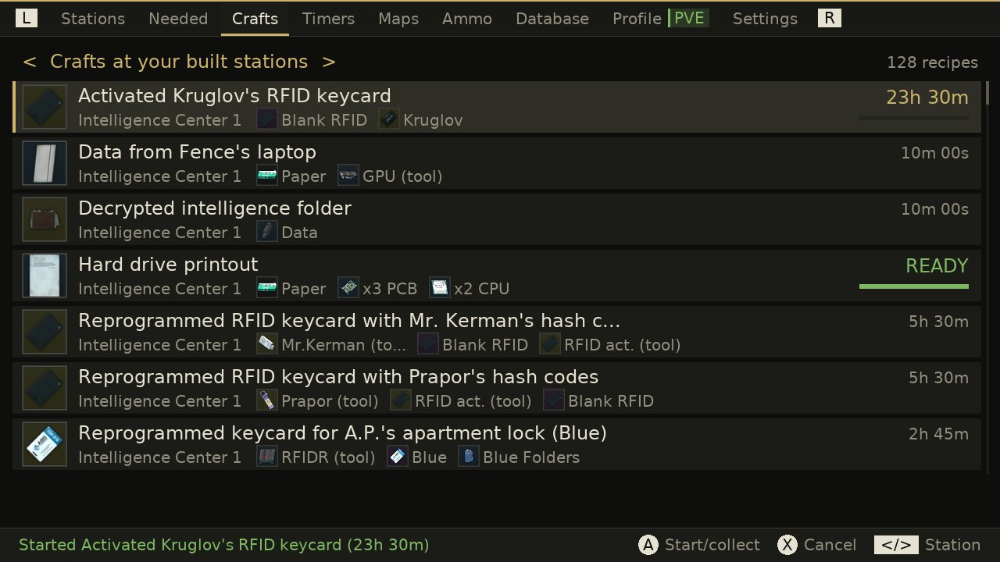</td>
<td>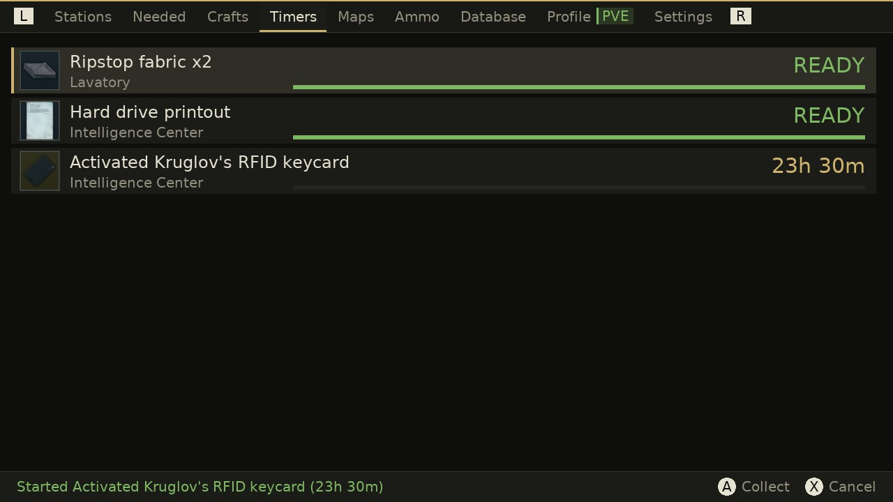</td>
</tr>
<tr>
<td><b>Crafts</b>. Recipes at the stations you've built, filterable by station. A starts a timer.</td>
<td><b>Timers</b>. Running and finished crafts. Collect or cancel them here.</td>
</tr>
</table>

## Maps

Pick a map, then pan and zoom. Maps are built from tarkov.dev's game renders, at up to the source resolution (Icebreaker reaches 14,773 px tall). Only the pieces on screen load, a few per frame, so panning stays smooth while the detail sharpens.

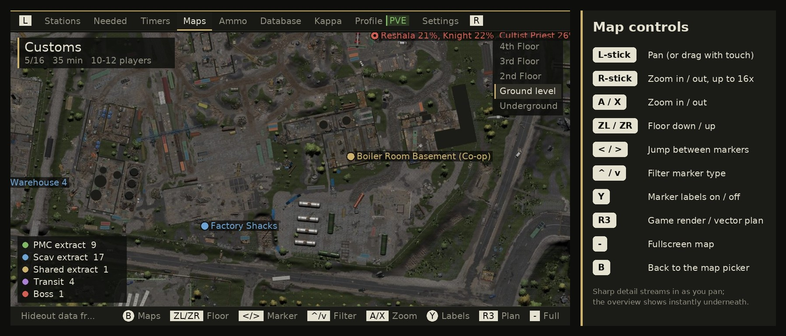

<table>
<tr>
<td width="50%">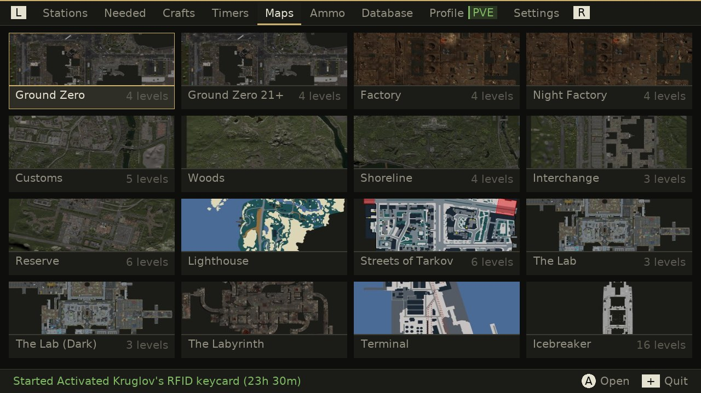</td>
<td width="50%">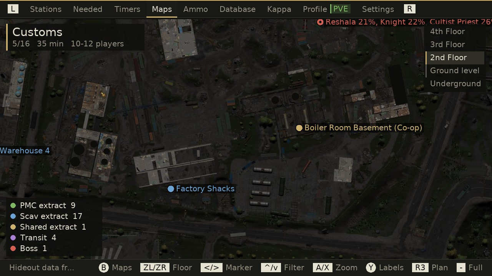</td>
</tr>
<tr>
<td><b>Map picker</b>. Every map with a preview and its number of levels.</td>
<td><b>Floors</b>. ZL / ZR steps through underground, ground and upper levels. The rest of the map dims.</td>
</tr>
<tr>
<td>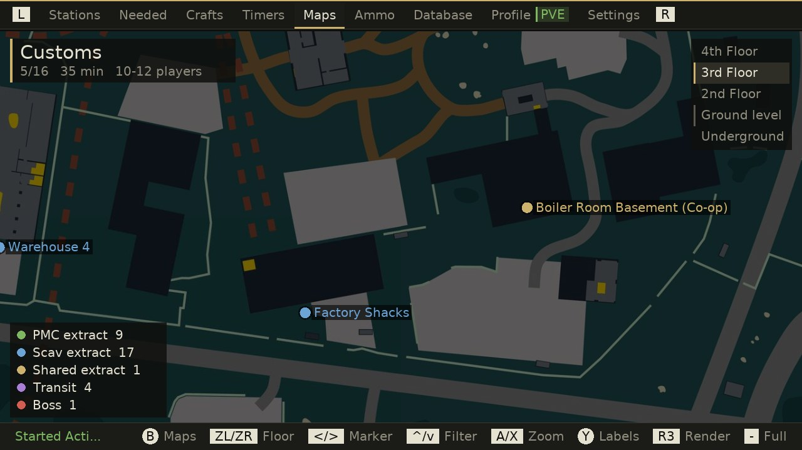</td>
<td>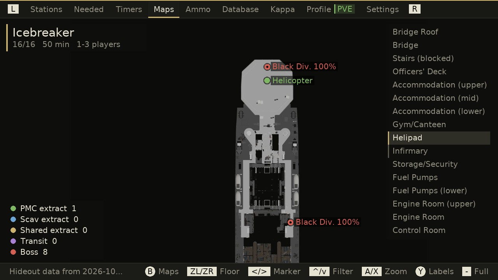</td>
</tr>
<tr>
<td><b>Vector plan</b>. R3 switches between the game render and tarkov.dev's clean plan.</td>
<td><b>Icebreaker</b>. All 16 decks, with the helicopter extract on the helipad.</td>
</tr>
</table>

Press Minus for a fullscreen map. Quest objectives and key locks open the map with a pin on the spot.

## Ammo

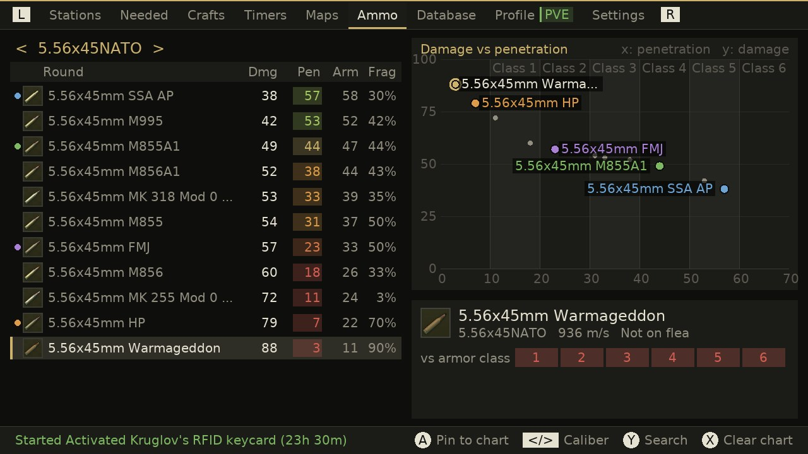

Every round with damage, penetration, armor damage and fragmentation, filterable by caliber. The chart plots damage against penetration with armor class columns, like [eft-ammo.com](https://eft-ammo.com). Pin up to eight rounds with A to compare them in color. The panel below shows speed, flea price and a rough read of each armor class.

## Gun builder

<table>
<tr>
<td width="50%">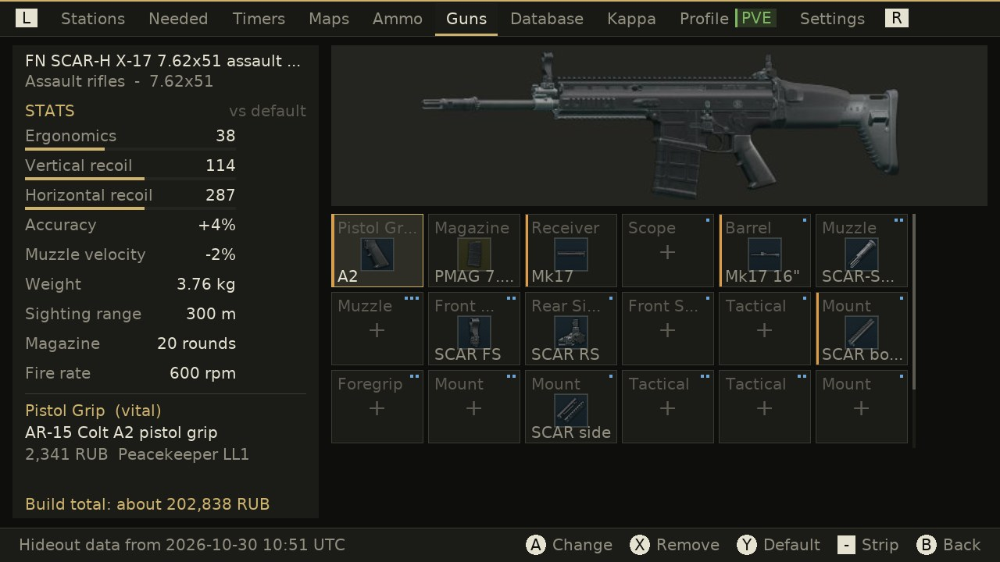</td>
<td width="50%">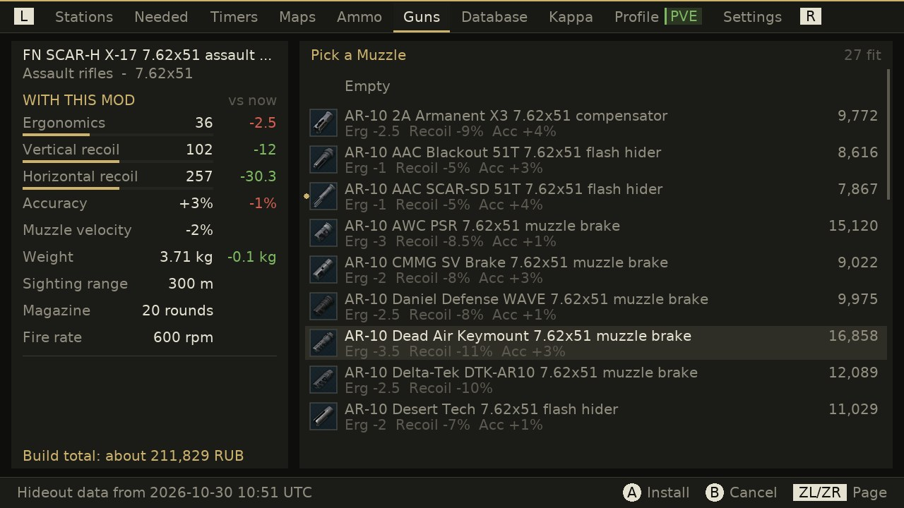</td>
</tr>
</table>

Try builds outside the game. The Guns tab lists every weapon by type (Left / Right) with its default build. Press A to open the builder: the weapon's slots sit under its picture as boxes, like the game's modding screen, and the mods installed in a slot add their own slots next to it. Press A on a slot to pick from every mod that fits, with its effect on ergonomics, recoil, accuracy and velocity and its cheapest price. Mods that clash with the rest of the build are marked, and required slots left empty turn red.

While you pick, the stats panel on the left previews the highlighted mod against your current build. Swapping a part keeps whatever is mounted on it that also fits the new one. The panel follows every change: ergonomics, vertical and horizontal recoil, accuracy, muzzle velocity, weight, sighting range and magazine size, each compared with the default build, plus the total price from traders or the flea market. Builds are saved per weapon. Y goes back to the default build and Minus strips every mod.

Prices are the lowest flea offer when the data was built (it refreshes daily), or the cheapest trader offer if that's lower. Settings > *Trader levels, for prices* sets your loyalty level with each trader, so the builder only quotes offers you can buy. Offers locked behind a quest count once you've done it (after a TarkovTracker sync).

Stats use the game's formulas on tarkov.dev's numbers: ergonomics and recoil match the game's default build for every weapon. Your skills and the ammo you load aren't counted.

## Quests

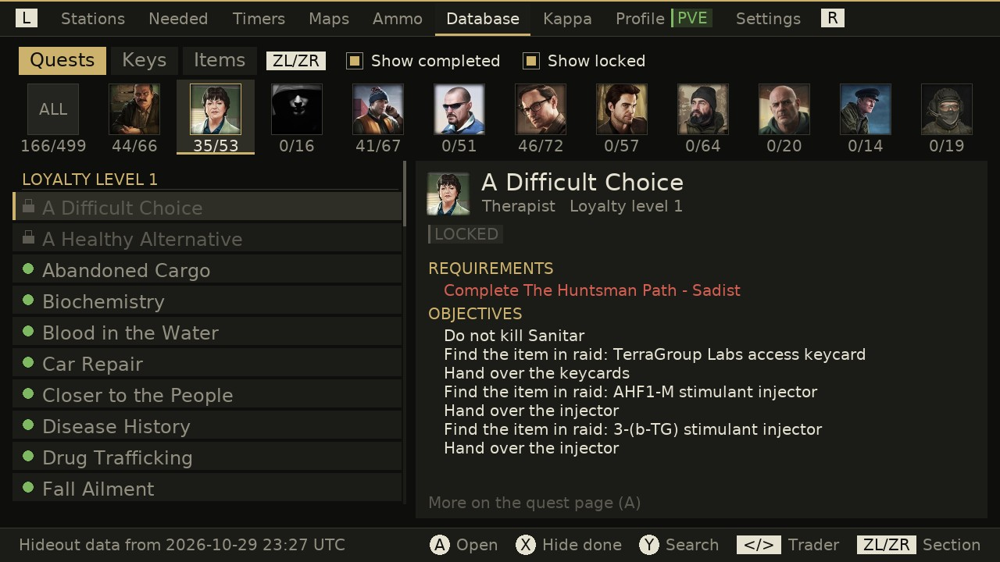

Laid out like the game's trader screen. Pick a trader from the portraits along the top (each shows how many of its quests you've done), or ALL. Quests are grouped under the loyalty level they need, and the panel on the right shows the selected quest's requirements (green when met), initial equipment, objectives and rewards.

- Each quest is marked **done** (green), **available** (ring) or **locked** (padlock: a quest before it isn't done, or your level is too low).
- **Show completed** (X) brings back finished quests. **Show locked** (-) hides the ones you can't take yet, once you've synced with TarkovTracker. The same switch is in Settings as *Hide quests I can't take yet*.
- **Search** (Y) looks through every trader and shows done and locked quests too.

<table>
<tr>
<td width="50%">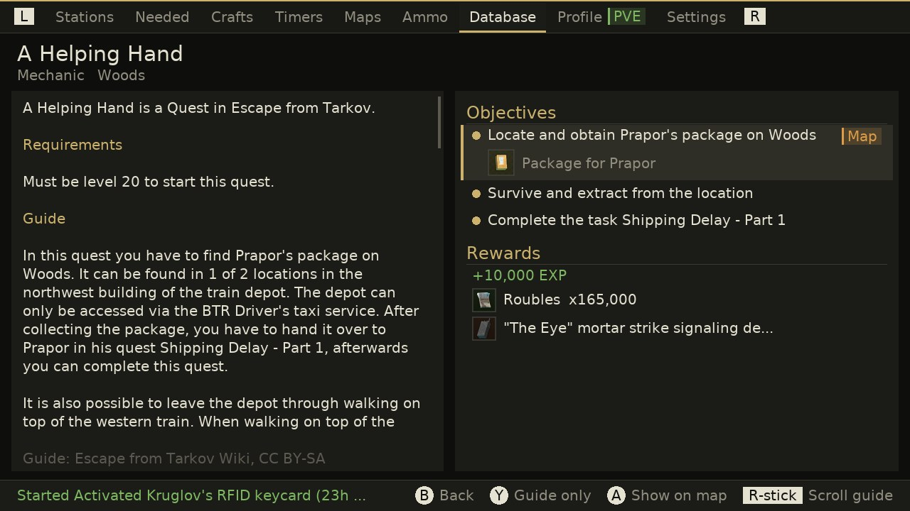</td>
<td width="50%">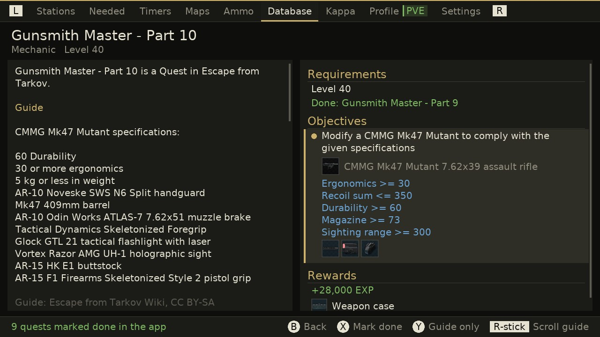</td>
</tr>
<tr>
<td><b>Quest page</b>. A opens it: the wiki guide with its pictures on the left; requirements, objectives (with Gunsmith build specs), map pins and rewards on the right. Y cycles guide + details, guide only and details only.</td>
<td><b>Catching up</b>. On a quest you're on, X ("I'm on this one") marks every quest before it in its chain done, and sends them to TarkovTracker when your token can write. See <a href="#profile-and-tarkovtracker-sync">sync</a>.</td>
</tr>
</table>

## Database

<table>
<tr>
<td width="50%">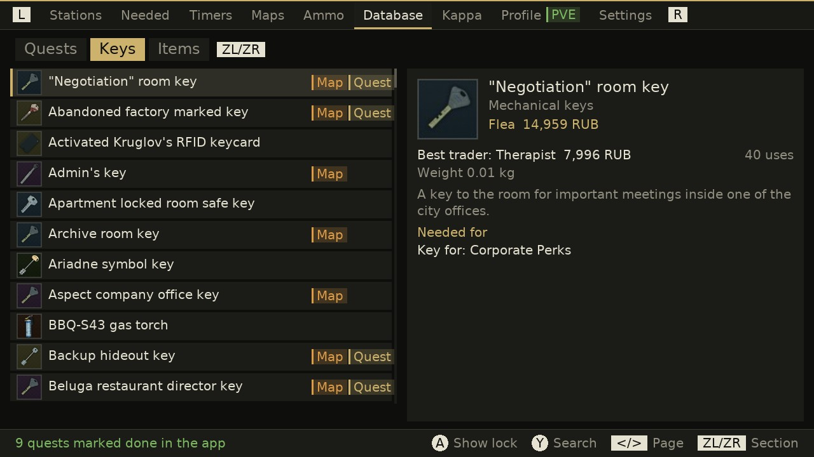</td>
<td width="50%">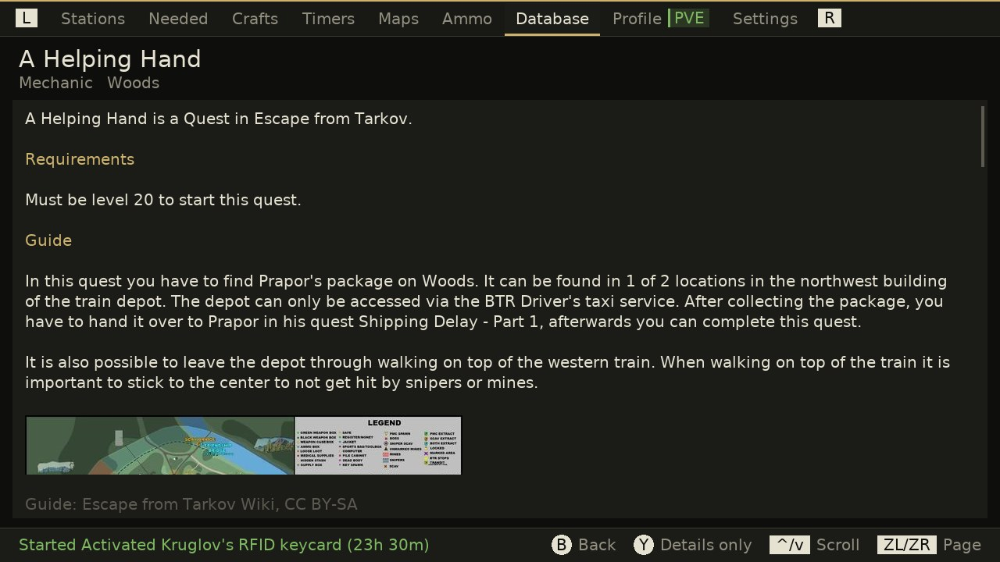</td>
</tr>
<tr>
<td><b>Keys</b>. What each key opens, which quests need it and where its lock is on the map.</td>
<td><b>Guide only</b>. The wiki guide across the whole screen, pictures included.</td>
</tr>
</table>

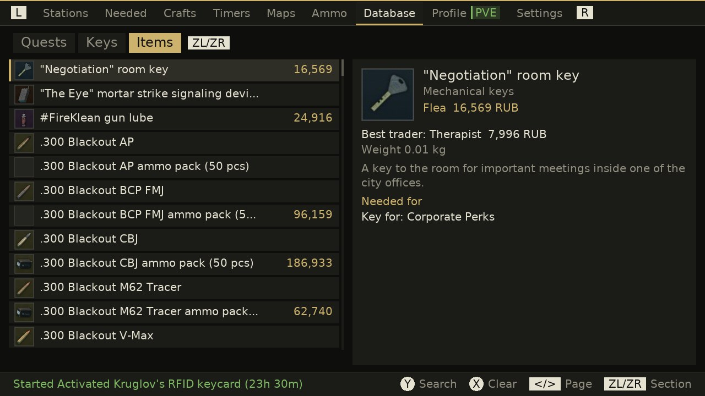

**Items**. Search any item for prices, best trader, description and what it's needed for (hideout, quests, crafts).

Quest guides and pictures come from the [Escape from Tarkov Wiki](https://escapefromtarkov.fandom.com) (CC BY-SA). The app downloads them from this repository's data branch, never from the wiki itself. Settings > *Download all wiki pictures* fetches any that aren't bundled yet.

<br clear="right">

## Kappa

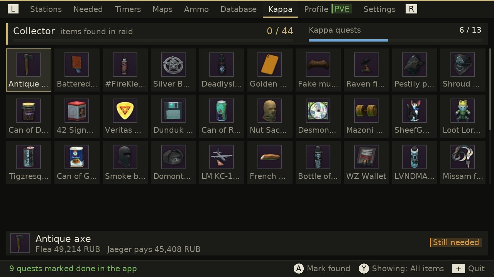

Every item the Collector quest asks for, with icons and flea and trader prices. Mark an item with A once you've found it in raid. The list is saved, and Y shows all items, only the ones still needed, or only the found ones. The top bar counts Collector items and the quests the Kappa container needs (after a TarkovTracker sync). When TarkovTracker says Collector is done, everything shows as found.

## Themes

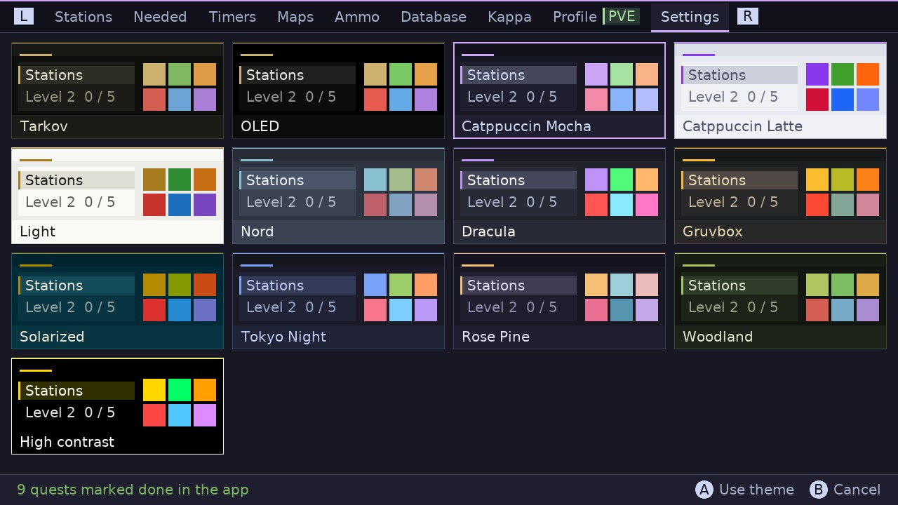

Settings > Theme opens a picker with 13 themes: Tarkov, OLED, Catppuccin Mocha and Latte, Light, Nord, Dracula, Gruvbox, Solarized, Tokyo Night, Rose Pine, Woodland and High contrast. Each card previews the theme's palette. Moving over a theme previews it across the whole app, A keeps it and B goes back. Map overlays stay dark on light themes so they remain readable over the map art.

## Profile and TarkovTracker sync

<table>
<tr>
<td width="50%">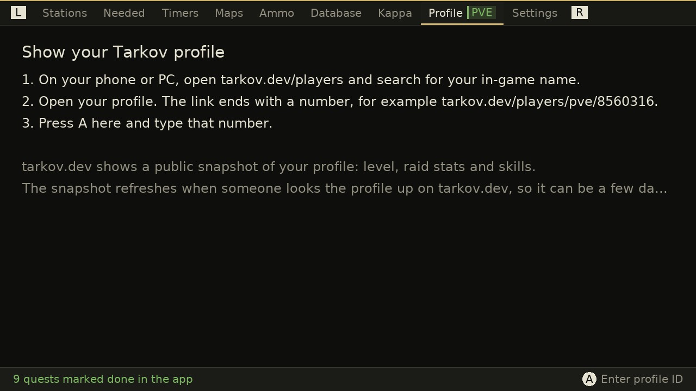</td>
<td width="50%">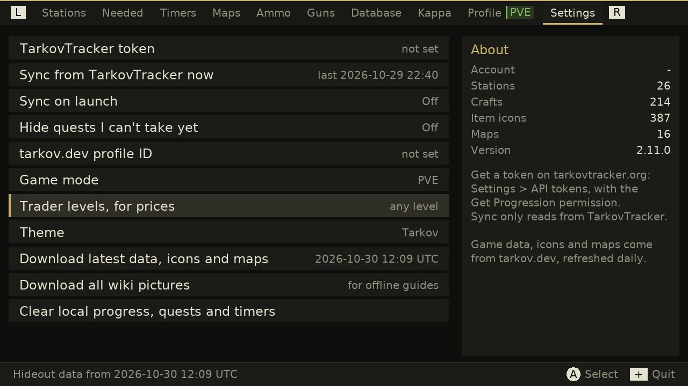</td>
</tr>
</table>

**Profile**. The tab is labelled with your player name and game mode. It shows the public snapshot tarkov.dev keeps of your account: level, PMC and Scav raid stats, and skills. Search your in-game name on [tarkov.dev/players](https://tarkov.dev/players), open your profile, and enter the number at the end of the link in the app. The snapshot refreshes when someone looks up the profile on tarkov.dev, so it can lag behind the game by a few days.

**TarkovTracker sync**

1. On tarkovtracker.org, open Settings and create an API token with the **Get Progression** permission (add **Write Progression** to let the app mark quests done for you). Tokens are tied to a game mode, so make a PVE token if you play PVE.
2. In the app, open Settings, choose the token row and enter the token.
3. The app syncs right away and on every launch (you can turn that off).

**Quest progress from the game.** The app never reads the game, but [TarkovMonitor](https://github.com/the-hideout/TarkovMonitor) can: it runs on the gaming PC, watches the game's logs and ticks quests on TarkovTracker as you accept and finish them, and the app picks them up on its next sync. TarkovMonitor only sees quests from the moment it runs, so the ones you finished before need catching up once.

**Catching up in a few presses.** Open a quest you currently have active in game and press X ("I'm on this one"): every quest before it in its chain is marked done. Do that for each active quest and your history is filled in. With a token that has the **Write Progression** permission, the app sends the same changes to TarkovTracker, so you never tick them one by one on the website. X again marks the quest itself done, then not done. Set your level on tarkovtracker.org once too.

**Hide quests I can't take yet** (Settings, or - on the quest list) needs a sync. A quest counts as locked while a quest before it isn't done, or your level is below what it asks. Your level is the higher of TarkovTracker's and your tarkov.dev profile's. Trader loyalty isn't synced anywhere, so loyalty requirements are shown but don't lock.

TarkovTracker's API is read-only for the hideout, so sync merges: levels and item counts from TarkovTracker are added to yours, and anything you set in the app is kept, even when TarkovTracker has no hideout progress. Use X on the Stations tab to undo a level.

## Controls

Switch buttons. On PC, see [PC second screen](#pc-second-screen) for the mouse and keyboard.

| Where | Button | Action |
| --- | --- | --- |
| Anywhere | L / R | Switch tab |
| Anywhere | + | Quit |
| Stations | Up / Down | Pick a station |
| Stations | ZL / ZR | View previous / next level |
| Stations | A | Mark the shown level as built |
| Stations | X | Undo the last built level |
| Stations | Right | Edit item counts for the shown level |
| Item counts | A / X / Y | +1 / -1 / all or none |
| Stations | - | Switch between stations and crafts |
| Crafts | Left / Right | Filter by station |
| Crafts | A | Start a timer, or collect a finished one |
| Crafts, Timers | X | Cancel a timer |
| Needed items | Left / Right | Page through the list |
| Needed items | Y | Show only found-in-raid items |
| Map picker | D-pad, A | Choose a map, open it |
| Maps | Left stick, touch | Pan |
| Maps | Right stick, A / X | Zoom in / out |
| Maps | ZL / ZR | Floor down / up |
| Maps | Left / Right | Jump between markers |
| Maps | Up / Down | Filter marker type |
| Maps | Y | Toggle labels |
| Maps | R3 (click right stick) | Game render / vector plan |
| Maps | - | Fullscreen map |
| Maps | B | Back to the map picker |
| Ammo | Left / Right | Caliber filter |
| Ammo | A | Pin or unpin the round on the chart |
| Ammo | ZL / ZR | Page through the list |
| Ammo | Y / X | Search / clear search, then clear the chart |
| Guns | Left / Right | Weapon type |
| Guns | A | Open the builder |
| Guns | Y / X | Search / clear search |
| Gun builder | D-pad, A | Pick a slot, change its mod |
| Gun builder | X | Remove the mod (and what's on it) |
| Gun builder | Y / - | Default build / strip all mods |
| Gun builder | B | Back to the weapon list |
| Database | ZL / ZR | Switch section: quests, keys, items |
| Quests | Left / Right | Pick a trader |
| Quests | X | Show or hide completed quests (clears the search first) |
| Quests | - | Show or hide locked quests (after a sync) |
| Database | Y / X | Search / clear search |
| Keys, Items | Left / Right | Page through the list |
| Database | A | Open quest, show key lock on the map |
| Quest page | Up / Down, A | Pick an objective or item, show it on the map |
| Quest page | X | Mark every earlier quest done ("I'm on this one"), then this one, then undo |
| Quest page | Right stick, ZL / ZR | Scroll the guide |
| Quest page | Y | Cycle guide + details, guide only, details only |
| Profile | A / X | Refresh / change profile ID |
| Kappa | D-pad | Pick an item |
| Kappa | A | Mark found / unmark |
| Kappa | Y | Show all, still needed or found |
| Theme picker | D-pad, A / B | Preview a theme, keep it / cancel |

## How the data works

`.github/workflows/data.yml` runs daily and publishes everything the app reads to the `data` branch:

- **Hideout, items, crafts and traders** from json.tarkov.dev, compacted to one small file per game mode.
- **Item icons**, packed into atlas pages.
- **Maps** rendered from tarkov.dev's map tiles and SVG plans. Each map is published as an overview image plus 1024 px pieces at several sharpness levels, with separate pieces for each floor. Extract, transit and boss positions are converted to map coordinates.
- **Quests, ammo and keys** for the database, and **wiki guides** with their pictures.

Daily runs reuse map renders and pictures that already exist, so they only push what changed. The app downloads fresh files when you choose *Download latest data* in Settings. NRO builds bundle the whole data branch for offline use.

## Building

```sh
# optional: bundle offline data, icons, map pieces and wiki pictures (a few hundred MB)
git clone --depth 1 -b data https://github.com/axewoo/TarkovHideout-NX data && rm -rf data/.git && cp -r data/. romfs/
docker run --rm -v "$PWD":/src -w /src devkitpro/devkita64 make
```

Desktop build, on Linux or MSYS2 UCRT64 on Windows (needs CMake, pkg-config, SDL2, SDL2_ttf, SDL2_image and libcurl):

```sh
cmake -S desktop -B build-desktop -DCMAKE_BUILD_TYPE=Release
cmake --build build-desktop -j
# data next to the program, or point TARKOV_DATA at a checkout of the data branch
git clone --depth 1 -b data https://github.com/axewoo/TarkovHideout-NX build-desktop/data
```

Android build (needs JDK 17, Gradle 8.7, and the Android SDK with NDK and CMake 3.22.1):

```sh
sh android/fetch-deps.sh   # SDL2, SDL2_ttf and SDL2_image sources
mkdir -p android/app/src/main/assets && cp desktop/font.otf desktop/icon.png android/app/src/main/assets/
python3 tools/bundle_lite.py data android/app/src/main/assets/data   # data: a checkout of the data branch
cd android && gradle assembleRelease
```

The desktop build compiles the same sources with `desktop/nxshim.cpp` standing in for libnx. `.github/workflows/desktop.yml` builds the Windows zip and Linux tarball, data included, and attaches them to releases. On Android, Java's HTTP client takes the place of libcurl, and `.github/workflows/android.yml` builds the APK. `tools/bundle_lite.py` picks the files the Lite NRO and the APK bundle.

Built with libnx, SDL2 (ttf, image), libcurl and nlohmann/json. The PC version uses the [Inter](https://github.com/rsms/inter) font (SIL OFL 1.1).

## Credits and licenses

This app's own code is under the [MIT License](LICENSE). The data, pictures and libraries below keep their own licenses.

**Data and pictures**

- Game data, item icons, map renders and map plans: [tarkov.dev](https://tarkov.dev) and the contributors credited there. The game's images and icons are the property of Battlestate Games.
- Quest guides and their pictures: the [Escape from Tarkov Wiki](https://escapefromtarkov.fandom.com) on Fandom, used under [CC BY-SA 3.0](https://creativecommons.org/licenses/by-sa/3.0/). The text is shortened and reformatted for the app, and these adapted guides (`wiki.json` and `wiki/` on the `data` branch) are shared under the same license. The app shows the credit under every guide.
- Player profiles: [tarkov.dev/players](https://tarkov.dev/players). Progress sync: the [TarkovTracker](https://tarkovtracker.org) API.

**Software**

- [libnx](https://github.com/switchbrew/libnx) (ISC) and the devkitPro toolchain, for the Switch build.
- [SDL2](https://libsdl.org), SDL2_ttf and SDL2_image (zlib license). The Android app also includes [HarfBuzz](https://harfbuzz.github.io) (MIT) and stb_image (public domain).
- [libcurl](https://curl.se) (curl license), [nlohmann/json](https://github.com/nlohmann/json) (MIT, included in `include/nlohmann`).
- Portions of this software are copyright © The [FreeType](https://freetype.org) Project. All rights reserved.
- This software is based in part on the work of the Independent JPEG Group (libjpeg-turbo), and uses libpng.
- [Inter](https://github.com/rsms/inter) font by The Inter Project Authors, SIL Open Font License 1.1 (`desktop/font-LICENSE.txt`), in the PC version.

The PC downloads include `THIRD-PARTY-NOTICES.txt` with these notices.

---

<sub>Not affiliated with Battlestate Games, tarkov.dev, TarkovTracker or the Escape from Tarkov Wiki. Escape From Tarkov is a trademark of Battlestate Games.</sub>
