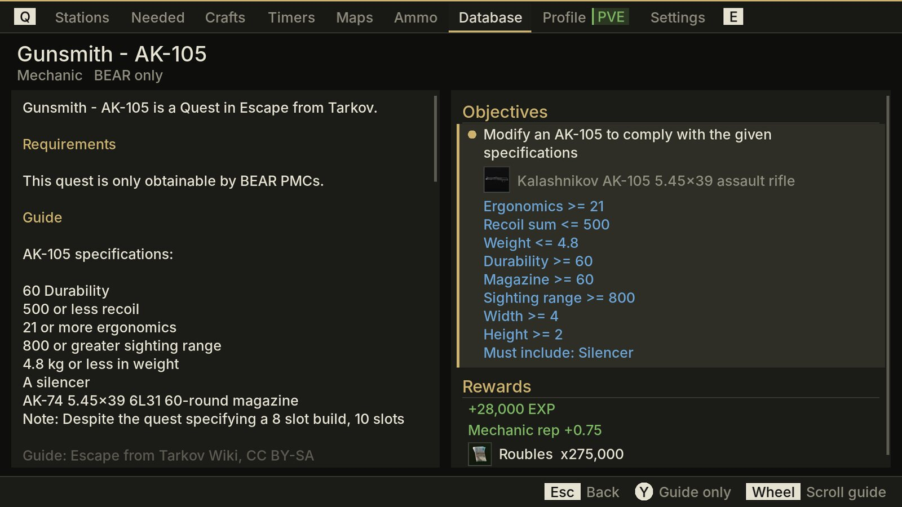

<div align="center">

# Tarkov Hideout for Switch and PC

**An offline Escape From Tarkov companion for Nintendo Switch homebrew, Windows and Linux.**
Hideout planner, craft timers, sharp interactive maps, an ammo chart and a quest database, in your hands between raids or on your second screen while you play.


[Install](#install) · [PC](#pc-second-screen) · [Hideout](#hideout) · [Maps](#maps) · [Ammo](#ammo) · [Database](#database) · [Profile and sync](#profile-and-tarkovtracker-sync) · [Controls](#controls) · [Building](#building)

</div>

---

## Highlights

- **Every hideout station and level**, with the items, tools and skills each one needs, and what you still have to find across the whole hideout.
- **Craft timers** that keep running while the Switch sleeps.
- **16 maps built from the game's own renders**, sharp up to 16x zoom, with extracts, transits, boss spawns and every floor of the multi-level maps.
- **An ammo tab** with an eft-ammo style damage vs penetration chart. Pin rounds to compare them.
- **Quest database** with wiki guides, pictures included, next to objectives, map pins and rewards.
- **Works fully offline.** Data, icons, maps and wiki pictures ship inside the app and refresh daily when you're online.
- **Runs on your PC too.** The same app for Windows and Linux, in a resizable window for a second screen, with mouse, keyboard or controller.
- **Never talks to Battlestate's servers.** Game data comes from [tarkov.dev](https://tarkov.dev), and you can pull your progress from [TarkovTracker](https://tarkovtracker.org).

## Install

### Switch

1. Download `TarkovHideout.nro` from the [latest release](../../releases/latest).
2. Copy it to `sdmc:/switch/` on your SD card.
3. Launch it from the Homebrew Menu. For the most memory, and for the on-screen keyboard, launch through title override (hold R while starting a game).

Progress and settings are saved in `sdmc:/switch/TarkovHideout/`. The app is a few hundred MB because every map piece and wiki picture is bundled for offline use.

### Windows

1. Download `TarkovHideout-windows-x64.zip` from the [latest release](../../releases/latest).
2. Unzip it anywhere and run `TarkovHideout.exe`. Nothing else to install.

### Linux

1. Download `TarkovHideout-linux-x64.tar.gz` from the [latest release](../../releases/latest) and extract it.
2. Install SDL2 and curl if you don't have them. On Arch and CachyOS: `sudo pacman -S --needed sdl2 sdl2_ttf sdl2_image curl`. On Debian and Ubuntu: `sudo apt install libsdl2-2.0-0 libsdl2-ttf-2.0-0 libsdl2-image-2.0-0 libcurl4`.
3. Run `./TarkovHideout`. `TarkovHideout.desktop` and `icon.png` are included for a menu entry.

On PC, progress, settings and downloads are saved in `%APPDATA%\TarkovHideout` (Windows) or `~/.local/share/TarkovHideout` (Linux), so a new version can replace the old folder. Builds from the latest commit are also on the [Build desktop](../../actions/workflows/desktop.yml) workflow page, under Artifacts.

## PC second screen

The PC version is the same app with the same tabs, data and TarkovTracker sync, in a window you can put on a second monitor while you play. It scales to any size, keeps text and maps sharp at high resolutions, and reopens where you left it.

<table>
<tr>
<td colspan="2"></td>
</tr>
<tr>
<td width="50%"></td>
<td width="50%"></td>
</tr>
</table>

- **Mouse.** Click tabs, rows, the `< filter >` labels and the button hints at the bottom, which all work as buttons. Double-click a row for its main action: open a quest, start a craft, pin a round, or add one of a hideout item. The wheel scrolls lists and quest guides and zooms the map around the pointer. Drag to pan. Right-click goes back.
- **Keyboard.** The hints at the bottom show keys instead of Switch buttons:

  | Key | Action |
  | --- | --- |
  | 1 to 9 | Jump to a tab |
  | Q / E, Tab | Previous / next tab |
  | Arrows, Enter, Esc | Move, select, back |
  | PgUp / PgDn | Same as ZL / ZR (floors, sections, levels) |
  | X, Y | Same as the Switch buttons |
  | Ctrl+F | Search |
  | F | Fullscreen map |
  | R | Game render / vector plan |
  | F11 | Fullscreen window |
  | Ctrl+Q | Quit |

- **Controller.** Any controller works like the Switch pad, and the hints switch back to Switch buttons while you use it.

Text boxes accept Ctrl+V, so you can paste your TarkovTracker token. It stays masked on screen apart from its last four characters, in case you stream the window.

## Hideout

<table>
<tr>
<td width="50%"></td>
<td width="50%"></td>
</tr>
<tr>
<td><b>Stations</b>. Pick a station to see the next level's requirements, mark levels as built and track item counts. Found-in-raid items are tagged.</td>
<td><b>Needed</b>. Everything still missing across the hideout, with which stations want it. Y shows only found-in-raid items.</td>
</tr>
<tr>
<td></td>
<td></td>
</tr>
<tr>
<td><b>Crafts</b>. Recipes at the stations you've built, filterable by station. A starts a timer.</td>
<td><b>Timers</b>. Running and finished crafts. Collect or cancel them here.</td>
</tr>
</table>

## Maps

Pick a map, then pan and zoom. Maps are built from tarkov.dev's game renders, at up to the source resolution (Icebreaker reaches 14,773 px tall). Only the pieces on screen load, a few per frame, so panning stays smooth while the detail sharpens.


<table>
<tr>
<td width="50%"></td>
<td width="50%"></td>
</tr>
<tr>
<td><b>Map picker</b>. Every map with a preview and its number of levels.</td>
<td><b>Floors</b>. ZL / ZR steps through underground, ground and upper levels. The rest of the map dims.</td>
</tr>
<tr>
<td></td>
<td></td>
</tr>
<tr>
<td><b>Vector plan</b>. R3 switches between the game render and tarkov.dev's clean plan.</td>
<td><b>Icebreaker</b>. All 16 decks, with the helicopter extract on the helipad.</td>
</tr>
</table>

Press Minus for a fullscreen map. Quest objectives and key locks open the map with a pin on the spot.

## Ammo


Every round with damage, penetration, armor damage and fragmentation, filterable by caliber. The chart plots damage against penetration with armor class columns, like [eft-ammo.com](https://eft-ammo.com). Pin up to eight rounds with A to compare them in color. The panel below shows speed, flea price and a rough read of each armor class.

## Database

<table>
<tr>
<td width="50%"></td>
<td width="50%"></td>
</tr>
<tr>
<td><b>Quests</b>. Every quest by trader. Quests completed on TarkovTracker are marked.</td>
<td><b>Quest page</b>. The wiki guide with its pictures on the left. Requirements, objectives (with Gunsmith build specs), map pins and rewards on the right.</td>
</tr>
<tr>
<td></td>
<td></td>
</tr>
<tr>
<td><b>Guide only</b>. Y cycles guide + details, guide only and details only.</td>
<td><b>Keys</b>. What each key opens, which quests need it and where its lock is on the map.</td>
</tr>
</table>


**Items**. Search any item for prices, best trader, description and what it's needed for (hideout, quests, crafts).

Quest guides and pictures come from the [Escape from Tarkov Wiki](https://escapefromtarkov.fandom.com) (CC BY-SA). The app downloads them from this repository's data branch, never from the wiki itself. Settings > *Download all wiki pictures* fetches any that aren't bundled yet.

<br clear="right">

## Profile and TarkovTracker sync

<table>
<tr>
<td width="50%"></td>
<td width="50%"></td>
</tr>
</table>

**Profile**. The tab is labelled with your player name and game mode. It shows the public snapshot tarkov.dev keeps of your account: level, PMC and Scav raid stats, and skills. Search your in-game name on [tarkov.dev/players](https://tarkov.dev/players), open your profile, and enter the number at the end of the link in the app. The snapshot refreshes when someone looks up the profile on tarkov.dev, so it can lag behind the game by a few days.

**TarkovTracker sync**

1. On tarkovtracker.org, open Settings and create an API token with the **Get Progression** permission. Tokens are tied to a game mode, so make a PVE token if you play PVE.
2. In the app, open Settings, choose the token row and enter the token.
3. The app syncs right away and on every launch (you can turn that off).

TarkovTracker's API is read-only for the hideout. Sync replaces the app's hideout progress with what TarkovTracker has, and changes you make in the app stay on the Switch until the next sync overwrites them.

## Controls

Switch buttons. On PC, see [PC second screen](#pc-second-screen) for the mouse and keyboard.

| Where | Button | Action |
| --- | --- | --- |
| Anywhere | L / R | Switch tab |
| Anywhere | + | Quit |
| Stations | Up / Down | Pick a station |
| Stations | ZL / ZR | View previous / next level |
| Stations | A | Mark the shown level as built |
| Stations | X | Undo the last built level |
| Stations | Right | Edit item counts for the shown level |
| Item counts | A / X / Y | +1 / -1 / all or none |
| Needed items | Left / Right | Page through the list |
| Needed items | Y | Show only found-in-raid items |
| Crafts | Left / Right | Filter by station |
| Crafts | A | Start a timer, or collect a finished one |
| Crafts, Timers | X | Cancel a timer |
| Map picker | D-pad, A | Choose a map, open it |
| Maps | Left stick, touch | Pan |
| Maps | Right stick, A / X | Zoom in / out |
| Maps | ZL / ZR | Floor down / up |
| Maps | Left / Right | Jump between markers |
| Maps | Up / Down | Filter marker type |
| Maps | Y | Toggle labels |
| Maps | R3 (click right stick) | Game render / vector plan |
| Maps | - | Fullscreen map |
| Maps | B | Back to the map picker |
| Ammo | Left / Right | Caliber filter |
| Ammo | A | Pin or unpin the round on the chart |
| Ammo | ZL / ZR | Page through the list |
| Ammo | Y / X | Search / clear search, then clear the chart |
| Database | ZL / ZR | Switch section |
| Database | Left / Right | Trader filter (page in Keys and Items) |
| Database | Y / X | Search / clear search |
| Database | A | Open quest, show key lock on the map |
| Quest page | Up / Down, A | Pick an objective or item, show it on the map |
| Quest page | Right stick, ZL / ZR | Scroll the guide |
| Quest page | Y | Cycle guide + details, guide only, details only |
| Profile | A / X | Refresh / change profile ID |

## How the data works

`.github/workflows/data.yml` runs daily and publishes everything the app reads to the `data` branch:

- **Hideout, items, crafts and traders** from json.tarkov.dev, compacted to one small file per game mode.
- **Item icons**, packed into atlas pages.
- **Maps** rendered from tarkov.dev's map tiles and SVG plans. Each map is published as an overview image plus 1024 px pieces at several sharpness levels, with separate pieces for each floor. Extract, transit and boss positions are converted to map coordinates.
- **Quests, ammo and keys** for the database, and **wiki guides** with their pictures.

Daily runs reuse map renders and pictures that already exist, so they only push what changed. The app downloads fresh files when you choose *Download latest data* in Settings. NRO builds bundle the whole data branch for offline use.

## Building

```sh
# optional: bundle offline data, icons, map pieces and wiki pictures (a few hundred MB)
git clone --depth 1 -b data https://github.com/axewoo/TarkovHideout-NX data && rm -rf data/.git && cp -r data/. romfs/
docker run --rm -v "$PWD":/src -w /src devkitpro/devkita64 make
```

Desktop build, on Linux or MSYS2 UCRT64 on Windows (needs CMake, pkg-config, SDL2, SDL2_ttf, SDL2_image and libcurl):

```sh
cmake -S desktop -B build-desktop -DCMAKE_BUILD_TYPE=Release
cmake --build build-desktop -j
# data next to the program, or point TARKOV_DATA at a checkout of the data branch
git clone --depth 1 -b data https://github.com/axewoo/TarkovHideout-NX build-desktop/data
```

The desktop build compiles the same sources with `desktop/nxshim.cpp` standing in for libnx. `.github/workflows/desktop.yml` builds the Windows zip and Linux tarball, data included, and attaches them to releases.

Built with libnx, SDL2 (ttf, image), libcurl and nlohmann/json. The PC version uses the [Inter](https://github.com/rsms/inter) font (SIL OFL 1.1).

## Credits and licenses

This app's own code is under the [MIT License](LICENSE). The data, pictures and libraries below keep their own licenses.

**Data and pictures**

- Game data, item icons, map renders and map plans: [tarkov.dev](https://tarkov.dev) and the contributors credited there. The game's images and icons are the property of Battlestate Games.
- Quest guides and their pictures: the [Escape from Tarkov Wiki](https://escapefromtarkov.fandom.com) on Fandom, used under [CC BY-SA 3.0](https://creativecommons.org/licenses/by-sa/3.0/). The text is shortened and reformatted for the app, and these adapted guides (`wiki.json` and `wiki/` on the `data` branch) are shared under the same license. The app shows the credit under every guide.
- Player profiles: [tarkov.dev/players](https://tarkov.dev/players). Progress sync: the [TarkovTracker](https://tarkovtracker.org) API.

**Software**

- [libnx](https://github.com/switchbrew/libnx) (ISC) and the devkitPro toolchain, for the Switch build.
- [SDL2](https://libsdl.org), SDL2_ttf and SDL2_image (zlib license).
- [libcurl](https://curl.se) (curl license), [nlohmann/json](https://github.com/nlohmann/json) (MIT, included in `include/nlohmann`).
- Portions of this software are copyright © The [FreeType](https://freetype.org) Project. All rights reserved.
- This software is based in part on the work of the Independent JPEG Group (libjpeg-turbo), and uses libpng.
- [Inter](https://github.com/rsms/inter) font by The Inter Project Authors, SIL Open Font License 1.1 (`desktop/font-LICENSE.txt`), in the PC version.

The PC downloads include `THIRD-PARTY-NOTICES.txt` with these notices.

---

<sub>Not affiliated with Battlestate Games, tarkov.dev, TarkovTracker or the Escape from Tarkov Wiki. Escape From Tarkov is a trademark of Battlestate Games.</sub>
